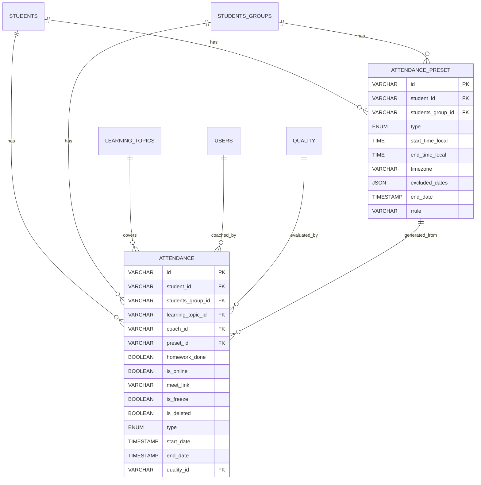

# Документация: Посещаемость (Attendance) и Шаблоны расписания (Preset)

Данный раздел описывает структуру таблиц, предназначенных для фиксации посещаемости занятий, планирования регулярных уроков, а также связи с сопутствующими сущностями (темы занятий, тренеры, оценки качества).

---

## 1. Диаграмма связей (ER-Diagram)



---

## 2. Схема таблицы `attendance` (Посещаемость)

Таблица фиксирует конкретные факты проведения занятий (как прошедших, так и запланированных в будущем).

| Поле | Тип данных | Описание | Ограничения / Значение по умолчанию |
| :--- | :--- | :--- | :--- |
| `id` | `VARCHAR(36)` | Уникальный идентификатор записи (UUID) | `PRIMARY KEY`, `NOT NULL` |
| `student_id` | `VARCHAR(36)` | Идентификатор ученика (для индивидуальных занятий) | `NULL`, `FOREIGN KEY` -> `students(id)` |
| `students_group_id`| `VARCHAR(36)` | Идентификатор группы (для групповых занятий) | `NULL`, `FOREIGN KEY` -> `students_groups(id)` |
| `learning_topic_id`| `VARCHAR(36)` | Изучаемая тема занятия | `NULL`, `FOREIGN KEY` -> `learning_topics(id)` |
| `coach_id` | `VARCHAR(36)` | Идентификатор тренера (преподавателя) | `NOT NULL`, `FOREIGN KEY` -> `users(id)` |
| `preset_id` | `VARCHAR(36)` | Ссылка на шаблон расписания, по которому создан урок | `NULL`, `FOREIGN KEY` -> `attendance_preset(id)` |
| `homework_done` | `BOOLEAN` | Флаг выполнения домашнего задания | `DEFAULT 0` (не выполнено) |
| `is_online` | `BOOLEAN` | Формат проведения (онлайн/офлайн) | `DEFAULT 0` (офлайн) |
| `meet_link` | `VARCHAR(200)`| Ссылка на онлайн-встречу (Zoom, Meet и т.д.) | `DEFAULT NULL` |
| `is_freeze` | `BOOLEAN` | Флаг заморозки занятия | `DEFAULT 0` |
| `is_deleted` | `BOOLEAN` | Флаг мягкого удаления записи | `DEFAULT 0` |
| `type` | `ENUM` | Тип занятия: `REGULAR`, `TRIAL`, `GROUP` | `DEFAULT 'REGULAR'` |
| `start_date` | `TIMESTAMP` | Дата и время начала занятия | `NULL` |
| `end_date` | `TIMESTAMP` | Дата и время окончания занятия | `NULL` |
| `quality_id` | `VARCHAR(36)` | Оценка качества проведения урока | `DEFAULT NULL`, `FOREIGN KEY` -> `quality(id)` |

### Бизнес-ограничения (CHECK Constraints)

Для обеспечения целостности данных на уровне СУБД наложено ограничение `chk_attendance_type_requirements`:
```sql
CONSTRAINT chk_attendance_type_requirements CHECK (
    (type IN ('REGULAR', 'TRIAL') AND student_id IS NOT NULL AND students_group_id IS NULL) OR
    (type = 'GROUP' AND student_id IS NULL AND students_group_id IS NOT NULL)
)
```
* **Логика**: Если занятие индивидуальное (`REGULAR` или `TRIAL`), то обязательно должен быть указан `student_id`, а `students_group_id` должен быть пуст. Если занятие групповое (`GROUP`), то наоборот — указывается только `students_group_id`.

---

## 3. Схема таблицы `attendance_preset` (Шаблоны расписания)

Используется для генерации регулярной сетки занятий на основе правил повторения (RRule).

| Поле | Тип данных | Описание | Ограничения / Значение по умолчанию |
| :--- | :--- | :--- | :--- |
| `id` | `VARCHAR(36)` | Уникальный идентификатор шаблона (UUID) | `PRIMARY KEY`, `NOT NULL` |
| `student_id` | `VARCHAR(36)` | Идентификатор ученика (для регулярных инд. занятий) | `NULL`, `FOREIGN KEY` -> `students(id)` |
| `students_group_id`| `VARCHAR(36)` | Идентификатор группы (для регулярных групповых занятий)| `NULL`, `FOREIGN KEY` -> `students_groups(id)` |
| `type` | `ENUM` | Тип шаблона: `REGULAR`, `GROUP` | `DEFAULT 'REGULAR'` |
| `start_time_local` | `TIME` | Локальное время начала занятия | `NOT NULL` |
| `end_time_local` | `TIME` | Локальное время окончания занятия | `NOT NULL` |
| `timezone` | `VARCHAR(50)` | Часовой пояс (например, `Europe/Moscow`) | `NOT NULL` |
| `excluded_dates` | `JSON` | Список дат-исключений, когда занятия не проводятся | `NOT NULL`, `DEFAULT (JSON_ARRAY())` |
| `end_date` | `TIMESTAMP` | Дата окончания действия регулярного правила | `NOT NULL` |
| `rrule` | `VARCHAR(500)`| Строка в формате RFC 5545 (RRule) для генерации дат | `NOT NULL` |

### Бизнес-ограничения (CHECK Constraints)

Ограничение `chk_attendance_preset_type_requirements`:
```sql
CONSTRAINT chk_attendance_preset_type_requirements CHECK (
    (type = 'REGULAR' AND student_id IS NOT NULL AND students_group_id IS NULL) OR
    (type = 'GROUP' AND student_id IS NULL AND students_group_id IS NOT NULL)
)
```
* **Логика**: Аналогично таблице посещаемости, шаблон должен быть строго привязан либо к конкретному ученику (для индивидуального расписания), либо к группе (для группового расписания).

---

## 4. Смежные таблицы

### `learning_topics` (Темы обучения)
Содержит справочник тем, которые проходятся на уроках. Позволяет отслеживать прогресс ученика или группы по учебной программе.

### `users` (Пользователи / Тренеры)
Таблица пользователей системы. В контексте посещаемости поле `coach_id` ссылается на пользователя с ролью тренера/преподавателя, проводящего занятие.

### `quality` (Оценка качества)
Таблица для хранения результатов контроля качества проведенного занятия (оценки, комментарии методистов или кураторов).