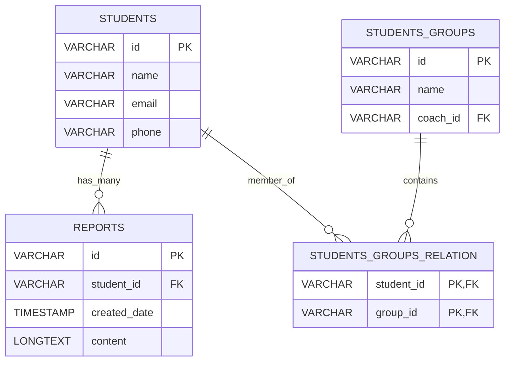

# Документация: Ученики (Students) и Группы (Students Groups)

Данный раздел описывает структуру таблиц, связанных с хранением информации об учениках, их объединении в учебные группы, а также фиксации отчетов об их успеваемости.

---

## 1. Диаграмма связей (ER-Diagram)

---

## 2. Схема таблицы `students` (Ученики)

Таблица содержит персональные и контактные данные учеников.

| Поле | Тип данных | Описание | Ограничения |
| :--- | :--- | :--- | :--- |
| `id` | `VARCHAR(36)` | Уникальный идентификатор ученика (UUID) | `PRIMARY KEY`, `NOT NULL` |
| `name` | `VARCHAR(100)`| Имя и фамилия ученика | `NOT NULL` |
| `email` | `VARCHAR(100)`| Электронная почта для связи и уведомлений | `UNIQUE` |
| `phone` | `VARCHAR(20)` | Номер телефона | `NULL` |

---

## 3. Схема таблицы `students_groups` (Группы учеников)

Группы объединяют нескольких учеников для проведения совместных занятий (тип посещаемости `GROUP`).

| Поле | Тип данных | Описание | Ограничения |
| :--- | :--- | :--- | :--- |
| `id` | `VARCHAR(36)` | Уникальный идентификатор группы (UUID) | `PRIMARY KEY`, `NOT NULL` |
| `name` | `VARCHAR(100)`| Название группы (например, "Python Start - Пн/Чт") | `NOT NULL` |
| `coach_id` | `VARCHAR(36)` | Основной тренер, закрепленный за группой | `FOREIGN KEY` -> `users(id)` |

*Связь между учениками и группами обычно реализуется через промежуточную таблицу связи (многие-ко-многим), позволяя ученику состоять в нескольких группах одновременно.*

---

## 4. Схема таблицы `reports` (Отчеты успеваемости)

Используется для фиксации прогресса обучения ученика. Отчеты могут содержать развернутую обратную связь от преподавателей.

| Поле | Тип данных | Описание | Ограничения / Значение по умолчанию |
| :--- | :--- | :--- | :--- |
| `id` | `VARCHAR(36)` | Уникальный идентификатор отчета (UUID) | `PRIMARY KEY`, `NOT NULL` |
| `student_id` | `VARCHAR(36)` | Идентификатор ученика, к которому относится отчет | `NOT NULL`, `FOREIGN KEY` -> `students(id)` |
| `created_date` | `TIMESTAMP` | Дата и время создания отчета | `DEFAULT CURRENT_TIMESTAMP`, `NOT NULL` |
| `content` | `LONGTEXT` | Содержимое отчета (текст обратной связи или ссылка) | `NOT NULL` |

### Особенности интеграции и представления
- **Хранение файлов**: На текущем этапе файлы отчетов планируется сохранять во внешнем S3-совместимом хранилище. В поле `content` при этом записывается структурированный JSON с метаданными и прямой ссылкой на скачивание файла, либо развернутый текстовый комментарий преподавателя.
- **Связь с посещаемостью**: Отчеты формируются на основе накопленной истории из таблицы `attendance` для конкретного `student_id` за определенный период обучения.